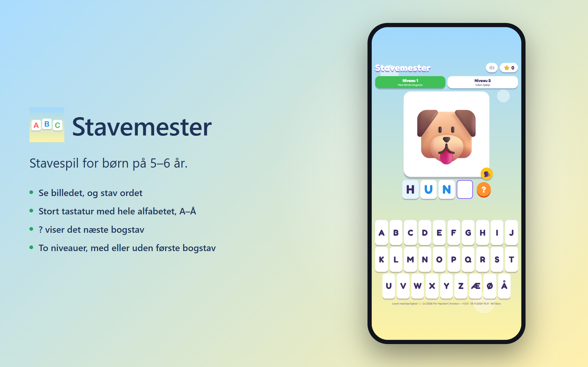

# Stavemester


[](LICENSE)
[](https://github.com/kreaton/Stavemester/stargazers)

⭐ Hvis Stavemester fortjener en plads på din maskine, så [giv det en stjerne på GitHub](https://github.com/kreaton/Stavemester) — det er gratis, lavet af én udvikler, og stjerner er det, der får andre til at finde det.



**Stavespil for børn på 5–6 år.**

▶️ **Spil det:** <https://kreaton.github.io/KidsGames/stavemester/>

Et billede vises sammen med en kasse pr. bogstav i ordet. Barnet trykker bogstaverne ind fra
et stort tastatur (A–Å). Et forkert bogstav giver en besked og en lyd, `?` viser det næste
bogstav (som barnet så selv skal finde på tastaturet), og et færdigt ord giver hurra.

- **Niveau 1** – første bogstav er skrevet på forhånd.
- **Niveau 2** – ingen hjælp.

## Ordbogen

Ordene ligger i `src/Stavemester/wwwroot/ordbog.json`:

```json
[
  { "word": "kat", "image": "🐱" },
  { "word": "hest", "image": "hest.jpg", "sound": "hest.mp3" }
]
```

| Felt    | Betydning |
|---------|-----------|
| `word`  | Ordet. Store/små bogstaver er ligegyldige; kun A–Z, Æ, Ø og Å (ord med andre tegn springes over). |
| `image` | En emoji, eller et filnavn (`.jpg`, `.png`, `.webp`, `.gif`, `.svg`) i `wwwroot/images/`. |
| `sound` | Valgfri. Et lydklip i `wwwroot/sounds/`, der afspilles når ordet vises og med 🗣️-knappen. |

Filen må indeholde kommentarer (`// ...` og `/* ... */`) og et komma efter sidste element, fx
til at slå et ord fra midlertidigt:

```json
  // { "word": "mille", "image": "IMG_9678.jpg" },
```

Ordene kommer i tilfældig rækkefølge, og alle ord vises én gang før nogen gentages.

## Kør og udgiv

```bash
dotnet run --project src/Stavemester
```

`src/Stavemester/Publish.bat` udgiver til `bin/Publish`. Ikonerne laves med
`powershell -File tools\make-icons.ps1`.

## Deploy

**GitHub Actions:** `.github/workflows/deploy.yml` udgiver ved hvert push til `main` (eller manuelt
fra fanen Actions) og lægger spillet i mappen `stavemester/` på KidsGames' GitHub Pages:
<https://kreaton.github.io/KidsGames/stavemester/>. Den bruger repository secret `PAGES_DEPLOY_KEY`.

## License & Authorship

This project is distributed under the terms of the [MIT License](LICENSE).

**AI authorship note:** Most of the source code in this repository was generated with AI coding agents (Claude Code), under my direction and review. Purely AI-generated material may not be eligible for copyright protection in some jurisdictions. To the extent any part of this project is protected by copyright, it is licensed under the MIT License, and the license's warranty and liability disclaimers apply to the project as a whole.

<!-- notices:start -->
### Independent development

Stavemester is an independent, personal project developed by Per Hejndorf. It is not affiliated with, endorsed by or sponsored by Microsoft or any other rights holder (including Google or ElevenLabs). Product names and logos are trademarks of their respective owners and are used only to identify the services and tools the project works with.

### Third-party notices and asset provenance

[THIRD-PARTY-NOTICES.md](THIRD-PARTY-NOTICES.md) lists every third-party library, font and online service the project uses, with version, licence, source and whether it was modified. It also records where the icons, images, audio and video came from and how they are licensed. A few assets are not covered by the MIT License; [THIRD-PARTY-NOTICES.md](THIRD-PARTY-NOTICES.md) marks them and states their terms.
<!-- notices:end -->
